# Ledger — AI Data Analyst

Upload one or more CSV files and ask about them in plain English. Ledger answers with numbers computed from your data, draws the chart, shows the SQL and pandas code it ran, flags anomalies and explains why each was flagged, forecasts, and keeps the conversation context so follow-ups like *"now break that down by month"* work.

The point of the project is the engineering around the model, not just a call to an LLM API. The model plans and explains. Every number comes from a tool that ran against the data, and every step can be checked in the UI.


> 🎬 **Demo video:** [`docs/demo.mp4`](docs/demo.mp4) (≈23 s) · **Screenshots:** [below](#screenshots)

---

## Contents

- [Features](#features)
- [Quick start](#quick-start)
- [Architecture](#architecture)
- [How a question is answered](#how-a-question-is-answered)
- [Safety model for LLM-written code](#safety-model-for-llm-written-code)
- [Configuration](#configuration)
- [Testing and evaluation](#testing-and-evaluation)
- [API](#api)
- [Project structure](#project-structure)
- [Assumptions and implementation notes](#assumptions-and-implementation-notes)
- [Limitations and next steps](#limitations-and-next-steps)
- [Screenshots](#screenshots)

---

## Features

### Core requirements

| Requirement | How it is met |
|---|---|
| Upload and validate one or more CSV files | Multi-file drag-and-drop. Each file is validated on its own, so one bad file doesn't block the others. Detects encoding (UTF-8/BOM/UTF-16/cp1252…) and the delimiter (`, ; \t \|`). Rejects non-CSV, binary, empty or header-only files and enforces size, row and column limits. Skips ragged rows and reports them. Every adjustment is reported to the user. |
| Answer questions in natural language | A tool-calling agent (Anthropic, OpenAI, Gemini, Groq, OpenRouter, Ollama) that streams its answer over SSE. |
| Business insights and summaries | Answers lead with the direct result, then give shares, growth, ranks and exceptions. *"Summarise the key insights"* runs a multi-query overview. |
| Charts (bar, line, pie, scatter…) | `create_chart` supports bar, horizontal bar, stacked/grouped bar, line, area, pie, donut, scatter (with trendline), histogram, box and heatmap. Charts are built from real query results, never from numbers the model typed. |
| SQL and/or pandas code | Every query the agent runs is shown with a **Run** button. Ask for code and you get runnable DuckDB SQL and pandas, and the test suite executes both to check they agree. |
| Detect anomalies and explain why | Robust z-scores (median/MAD), scored per product for price-like columns and on a log scale for skewed amounts. Rule checks catch negative quantities and prices. Time-series checks catch spikes and drops against a rolling median. Each flag comes with a plain-language reason, e.g. *"Unit price of 131,470 is 101× the typical 1,302 for P001"*. |
| Explain the reasoning | Each step shows the tool, its stated *purpose*, the input, the SQL, a result preview and timing. Answers end with a **How I got this** section that names tables, filters, joins and assumptions. |
| Conversation context | Recent turns are replayed with their tool calls and results. Older turns are compacted to question + answer + the SQL used, within a fixed budget. |

### Bonus features

- **Multi-file analysis.** Join keys are detected automatically from name match plus value overlap, with cardinality. The model is told which keys to join on (e.g. *top customers* joins `sales_orders` → `customers` to show names; *targets* joins actuals with `regional_targets`).
- **Dashboard generation.** An instant, deterministic dashboard (KPIs, trend, breakdowns, share, distribution) built from the column profile. No LLM call.
- **Data-quality checks.** Per-file score (0–100) and issues: duplicates, repeated IDs, missing values, inconsistent labels (`West`/`west `), unexpected negatives, extreme values, future dates. One-click fixes: drop duplicates, normalise labels.
- **Forecasting.** Holt-Winters with a damped trend (seasonal when there are two full seasons), smoothing parameters fitted by grid search. 80%/95% intervals, a hold-out backtest MAPE, and one-off outlier periods capped before fitting.
- **Agentic workflow and tool calling.** Multi-step plans. SQL errors are fed back so the model can fix its own query. There's a step budget that ends in a forced final answer.
- **Streaming.** Tokens, steps and charts stream to the UI as they happen (SSE over POST). Answers can be stopped mid-stream.
- **Caching.** Repeat questions in the same context are served from an answer cache. Query results sit in a TTL/LRU cache. Anthropic prompt caching is used for the system prompt and tools.
- **Authentication.** Optional bearer token (`APP_ACCESS_TOKEN`) with a login screen in the UI.
- **Rate limiting.** Per-client sliding window on the chat endpoint, which protects LLM spend.
- **Observability.** JSON structured logs with request and session IDs. `/api/metrics` in JSON or Prometheus format: request latency, LLM calls and latency, tokens, tool calls and errors, cache hits.
- **Evaluation framework.** Twelve cases checked against SQL ground truth, runnable against any provider (see [Evaluation](#evaluation)).
- **Report export.** The whole session as a standalone HTML report (interactive Plotly charts) or Markdown.
- **Offline engine.** A deterministic planner that speaks the same tool protocol. The app works with **no API key** and falls back to it automatically if the LLM is down.
- Light and dark themes, keyboard-first composer, accessible markup, CSV download of every table.

---

## Quick start

### Option A: Docker (recommended)

```bash
git clone https://github.com/daksh2204/ai-data-analyst-.git ai-data-analyst && cd ai-data-analyst
cp .env.example .env          # add ONE API key (or leave empty for the offline engine)
docker compose up --build
```

Open **http://localhost:8000** and click **Load sample data**.

### Option B: Local development

Requirements: Python 3.11+ and Node 20+.

```bash
# API
cd backend
python -m venv .venv && source .venv/bin/activate      # Windows: .venv\Scripts\activate
pip install -r requirements-dev.txt
cp ../.env.example ../.env                               # add an API key
uvicorn app.main:app --reload --port 8000

# UI (second terminal)
cd frontend
npm ci
npm run dev                                              # http://localhost:5173 (proxies /api to :8000)
```

To serve the UI from the API (as in Docker), run `npm run build` in `frontend/`. FastAPI then serves `frontend/dist` at http://localhost:8000.

### Getting an API key

Any one of these is enough. The provider is picked automatically from whichever key is set.

| Provider | Variable | Notes |
|---|---|---|
| Anthropic | `ANTHROPIC_API_KEY` | Native tool use and prompt caching |
| OpenAI | `OPENAI_API_KEY` | |
| Google Gemini | `GEMINI_API_KEY` | Free tier at Google AI Studio |
| Groq | `GROQ_API_KEY` | Free tier, very fast |
| OpenRouter | `OPENROUTER_API_KEY` | Any model OpenRouter offers |
| Ollama (local) | `OLLAMA_BASE_URL` | e.g. `http://localhost:11434`. No key, nothing leaves the machine |

Set `LLM_MODEL` to choose a specific model.

---

## Architecture


<details>
<summary>Mermaid source (renders on GitHub)</summary>

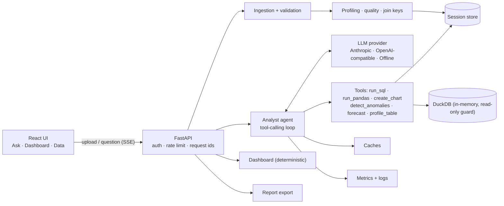
</details>

| Layer | Choice | Why |
|---|---|---|
| UI | React 18 + TypeScript + Vite, Plotly (cartesian bundle, lazy-loaded) | Typed SSE event handling and rich interactive charts. Plotly figures are JSON the backend can build and the HTML report can embed. |
| API | FastAPI + Pydantic Settings | Async streaming, validation and OpenAPI docs at `/docs`. |
| Query engine | DuckDB (in-memory, one per session) | Fast analytical SQL over CSVs, real joins across files, a SQL dialect LLMs know well, and the ability to switch off external access. |
| Analysis | pandas + NumPy | Profiling, anomaly scoring, Holt-Winters. Implemented directly, without heavy ML dependencies, so the image stays small. |
| LLM | Provider-neutral interface with Anthropic and OpenAI-compatible adapters | One agent loop and many providers. Swapping models is a config change. |

Detailed design notes live in [`docs/ARCHITECTURE.md`](docs/ARCHITECTURE.md).

---

## How a question is answered

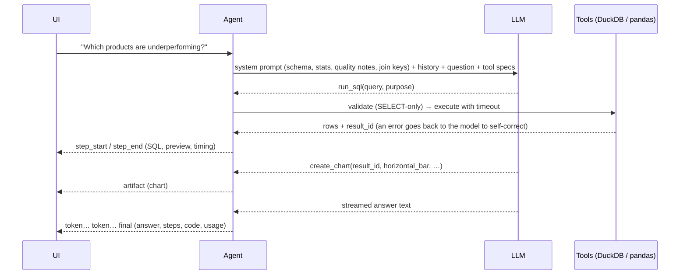

1. **Grounding.** The system prompt holds a compact profile of every table: column types and roles, ranges, top values, null rates, data-quality notes and detected join keys. The model writes correct SQL on the first try far more often, and is told to normalise inconsistent labels.
2. **Tools, not guesses.** The model must get every figure from a tool. Charts reference a `result_id`, so the plotted data is exactly what the query returned.
3. **Self-correction.** Tool errors (bad column, syntax error, blocked statement, timeout) come back as structured error results, and the model retries with a fix.
4. **Explainability.** Each tool call carries a one-sentence `purpose`, shown as the reasoning for that step, alongside the code and a result preview. This shows the actual work done, not hidden chain-of-thought.
5. **Memory.** The last few turns are replayed verbatim, including tool results, so the model can build on previous queries. Older turns are compacted.
6. **Resilience.** If the provider fails (bad key, quota, outage), the turn is answered by the offline engine and a notice tells the user. If it fails mid-analysis, the user still gets the results computed so far.

---

## Safety model for LLM-written code

The model writes code that runs on the server, so it is treated as untrusted input:

**SQL (`run_sql`)**
- Exactly one statement, and DuckDB's own parser must classify it as `SELECT`. `DROP`, `INSERT`, `COPY`, `ATTACH`, `SET`, `INSTALL` and stacked statements are rejected.
- `enable_external_access = false` plus `lock_configuration = true`, so `read_csv('/etc/passwd')`, HTTP reads and extension loading are impossible and can't be re-enabled.
- In-memory database holding only copies of the uploaded files. Wall-clock timeout via `interrupt()`, row cap and memory limit.

**pandas (`run_pandas`)**
- AST allow-list checked before execution: no imports, dunder or private attribute access, `eval`/`exec`/`open`/`getattr`, `while` loops, `try`/`with`, file I/O methods (`to_csv`, `read_*`…) or `DataFrame.query/eval`.
- Minimal builtins, capped `range`, a line-level trace deadline plus a thread timeout, and copy-on-write frames, so session data can't be mutated.
- For a multi-tenant deployment, run this tool in an isolated sandbox (gVisor, Firecracker or a separate container). This is noted in the code.

Both guards are covered by tests (`tests/test_security.py`).

---

## Configuration

All settings are environment variables (or `.env`). See [`.env.example`](.env.example).

| Variable | Default | Purpose |
|---|---|---|
| `LLM_PROVIDER` | `auto` | `auto` picks the first provider with a key; or `anthropic`, `openai`, `gemini`, `groq`, `openrouter`, `ollama`, `offline` |
| `LLM_MODEL` | per provider | Model override |
| `LLM_FALLBACK_TO_OFFLINE` | `true` | Answer with the offline engine if the LLM call fails |
| `AGENT_MAX_STEPS` | `8` | Tool rounds before a final answer is forced |
| `APP_ACCESS_TOKEN` | unset | Require a bearer token for the API and UI |
| `CHAT_RATE_LIMIT_PER_MINUTE` | `30` | Questions per minute per client (`0` disables) |
| `MAX_UPLOAD_MB` / `MAX_FILES_PER_SESSION` | `50` / `10` | Upload limits |
| `QUERY_TIMEOUT_SECONDS` / `PANDAS_TIMEOUT_SECONDS` | `15` / `10` | Execution limits |
| `SESSION_TTL_MINUTES` | `120` | Idle session expiry |
| `LOG_FORMAT` | `text` (`json` in Docker) | Structured logs for aggregation |

---

## Testing and evaluation

```bash
cd backend
pytest                 # 106 tests: ingestion, security guards, analysis, agent loop, provider contracts, API
ruff check app tests evals
cd ../frontend && npm test && npm run typecheck
```

What the tests cover:

- **Agent loop** (`test_agent.py`): a scripted fake LLM drives the real loop. It covers multi-step tool use, SQL self-correction, refusing unsafe SQL, conversation memory across turns, the step budget, falling back to offline on LLM failure, and answer caching.
- **Provider contracts** (`test_provider_contracts.py`): the real Anthropic and OpenAI SDKs run unmodified against wire-format streaming responses, including tool-call arguments split across chunks, usage and prompt-cache accounting, and error mapping.
- **Security** (`test_security.py`): 25+ attempted escapes against the SQL guard and the pandas sandbox.
- **Analysis** (`test_analysis.py`): the anomaly detector must find every anomaly type injected into the sample data and stay quiet on clean data. Forecast intervals must be ordered. Quality checks must find the planted issues.
- **API** (`test_api.py`): uploads with mixed valid and invalid files, fixes, the read-only query endpoint, SSE chat, report export, auth, rate limits and metrics.

### Evaluation

`backend/evals/` is a small evaluation framework. Each case in [`cases.yaml`](backend/evals/cases.yaml) is a question plus checks whose expected values are **computed by SQL at run time**: the answer must name the right entity or number, call the right tools, produce the right chart type, and generate code that runs. Some cases are follow-ups that test memory.

```bash
cd backend
python -m evals.run_evals                         # uses the provider in .env
python -m evals.run_evals --provider offline      # deterministic baseline (runs in CI)
python -m evals.run_evals --provider gemini --model gemini-2.5-flash
```

Reports (pass rate, latency, tokens, tool errors per case) are written to `backend/evals/results/`. Offline baseline: **12/12** ([report](backend/evals/results/offline-heuristic-planner-latest.md)). Run it with your key to benchmark models against each other.

CI (`.github/workflows/ci.yml`) runs lint, tests, the evals, the frontend typecheck, tests and build, then builds the Docker image and smoke-tests a real question against the container.

---

## API

Interactive docs at **`/docs`** (OpenAPI). Main endpoints:

| Method | Path | Description |
|---|---|---|
| `POST` | `/api/sessions` | Create an analysis session |
| `POST` | `/api/sessions/{id}/datasets` | Upload one or more CSVs (multipart `files`) |
| `POST` | `/api/sessions/{id}/datasets/samples` | Load the bundled sample data |
| `GET` | `/api/sessions/{id}/datasets/{table}` | Profile, quality issues, preview |
| `POST` | `/api/sessions/{id}/datasets/{table}/fix` | Apply a quality fix |
| `POST` | `/api/sessions/{id}/chat` | Ask a question. Streams SSE events: `start`, `thought`, `step_start`, `step_end`, `artifact`, `token`, `notice`, `final`, `error` |
| `GET` | `/api/sessions/{id}/dashboard` | Auto-generated dashboard |
| `POST` | `/api/sessions/{id}/query` | Run read-only SQL directly |
| `GET` | `/api/sessions/{id}/report?format=html\|md` | Export the session |
| `GET` | `/api/health`, `/api/config`, `/api/metrics` | Health, client config, metrics (`?format=prometheus`) |

Errors always share one shape: `{"error": {"code": "...", "message": "...", "details": {...}}}`.

---

## Project structure

```
├── backend/
│   ├── app/
│   │   ├── agent/            # agent loop, tools, prompts, memory
│   │   │   └── llm/          # provider interface, Anthropic, OpenAI-compatible, offline planner
│   │   ├── analysis/         # anomalies, forecasting, charts, dashboard, pandas sandbox
│   │   ├── data/             # ingestion & validation, DuckDB engine + SQL guard, profiling, relationships
│   │   ├── api/              # routes, dependencies (auth, rate limit), schemas
│   │   ├── core/             # errors, logging, metrics, cache, rate limiter
│   │   ├── reports/          # HTML / Markdown export
│   │   ├── sessions/         # session store
│   │   ├── config.py
│   │   └── main.py           # app factory, middleware, SPA serving
│   ├── evals/                # evaluation cases + harness
│   └── tests/                # pytest suite
├── frontend/src/             # React app (components, hooks, API client, styles)
├── sample_data/              # sample CSVs (see below)
├── scripts/
│   ├── generate_sample_data.py
│   └── record_demo.py        # records screenshots + demo video with Playwright
├── docs/                     # architecture diagram, screenshots, demo video
├── Dockerfile · docker-compose.yml · .env.example
└── .github/workflows/ci.yml
```

### Sample data

`sample_data/` holds a small, realistic sales dataset. It is synthetic and generated reproducibly by `scripts/generate_sample_data.py` (seed 42):

| File | Rows | Contents |
|---|---|---|
| `sales_orders.csv` | 6,462 | Orders for 2023–2024: date, customer, product, region, channel, quantity, price, discount, revenue, status |
| `customers.csv` | 320 | Customer name, segment, region, city |
| `products.csv` | 30 | Product name, category, list price, unit cost |
| `regional_targets.csv` | 120 | Monthly revenue target per region |
| `marketing_spend.csv` | 480 | Monthly spend and leads by region and channel (extra file for upload) |
| `messy_hr_example.csv` | 12 | Deliberately messy: currency strings, %, mixed dates, duplicate headers, blank rows (shows validation) |

Patterns built into the data, so the answers have something real to find:
- Q4 seasonality and about 29% year-over-year growth.
- A few dominant customers.
- Products in decline in 2024 (Legacy CRM Desktop, DVD Writer X2, Fax Machine Classic).
- A South-region outage in March 2024.
- A flash-sale spike on 2024-11-29.
- Four bulk orders, three negative quantities and two ×100 unit-price typos.
- Three duplicate rows and about 1.5% missing discounts.

---

## Assumptions and implementation notes

- **Sessions are in memory.** An analysis session is a scratchpad: uploads, results and history live in the server process and expire after `SESSION_TTL_MINUTES` of inactivity. Nothing is written to disk. The container runs a single worker for this reason (see *Scaling*).
- **The data is already in CSV.** Excel files are rejected with a hint to export as CSV. Columns are renamed to SQL-safe `snake_case`, and the original headers are kept and shown.
- **Currency is not assumed.** Values like `$1,234` are parsed as numbers, but answers don't invent currency symbols the data doesn't specify.
- **"Underperforming"** defaults to the change in the measure between the last 12 months and the previous 12, ranked by growth rate, with share of revenue shown for context. With targets uploaded, *"missed target"* questions compare actuals with targets instead.
- **Anomalies are statistical signals, not verdicts.** Each one is explained so a person can decide, and the answer suggests likely causes (returns, keying errors, bulk deals).
- **The offline engine** covers the common business question types: rankings, trends, under-performers, targets, anomalies, forecasts, quality, correlation, joins and code requests. It exists so the app is usable without a key, works as a fallback, and gives CI a deterministic baseline. Open-ended reasoning needs a real LLM.
- **Screenshots and the demo** in this repository were recorded with `scripts/record_demo.py`. To re-record them with your own model:
  ```bash
  pip install playwright && python -m playwright install chromium
  python scripts/record_demo.py          # app running on :8000 → docs/screenshots/*.png, docs/demo.mp4, docs/demo.gif
  ```

### Scaling

To run more than one instance:
1. Move the session store to Redis, and store uploaded files and per-session tables in object storage as Parquet, reloaded into DuckDB on demand.
2. Move the caches and the rate limiter to Redis.
3. Run `run_pandas` in an isolated sandbox service.
4. Export metrics with OpenTelemetry.

The interfaces (`SessionStore`, `TTLCache`, `RateLimiter`, `metrics`) were kept small so each of these is a contained change.

---

## Limitations and next steps

- Very large files (hundreds of MB) should go straight into DuckDB via `read_csv` rather than through pandas. The ingestion path is the place to change this.
- Semantic search over column descriptions and values (embeddings) would help with wide schemas. Today the full compact profile fits in the prompt.
- Sessions don't persist across server restarts (by design, see above).
- PDF export of reports. HTML export prints cleanly to PDF from the browser in the meantime.

---

## Screenshots

| | |
|---|---|
| **Files loaded, suggested questions**<br>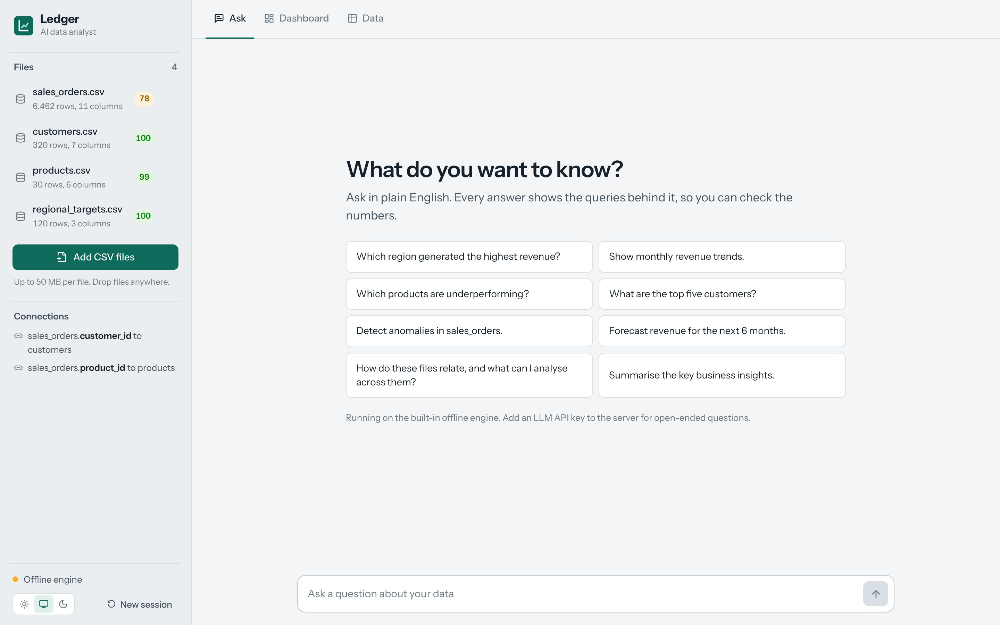 | **Answer + chart + table**<br>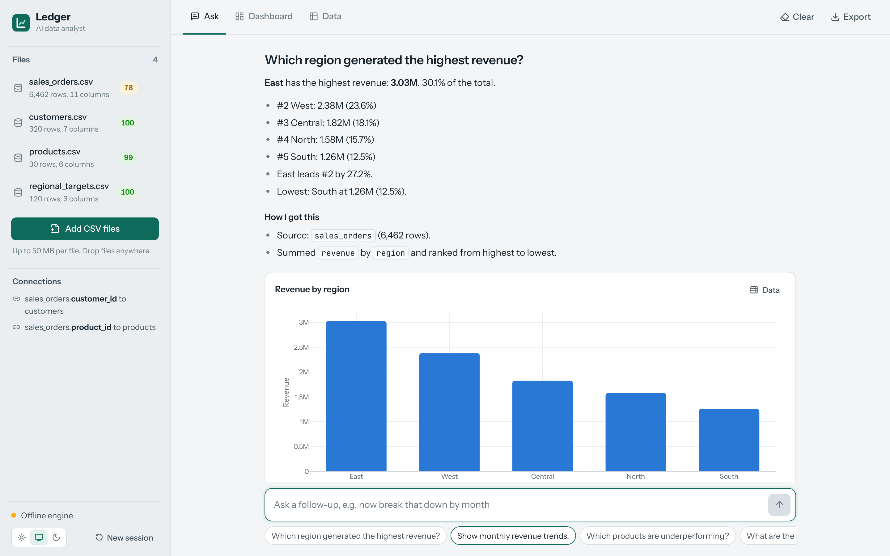 |
| **Monthly trend**<br>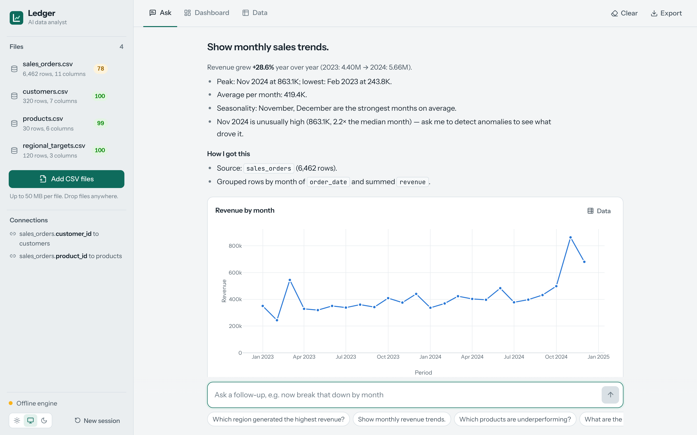 | **Underperforming products**<br>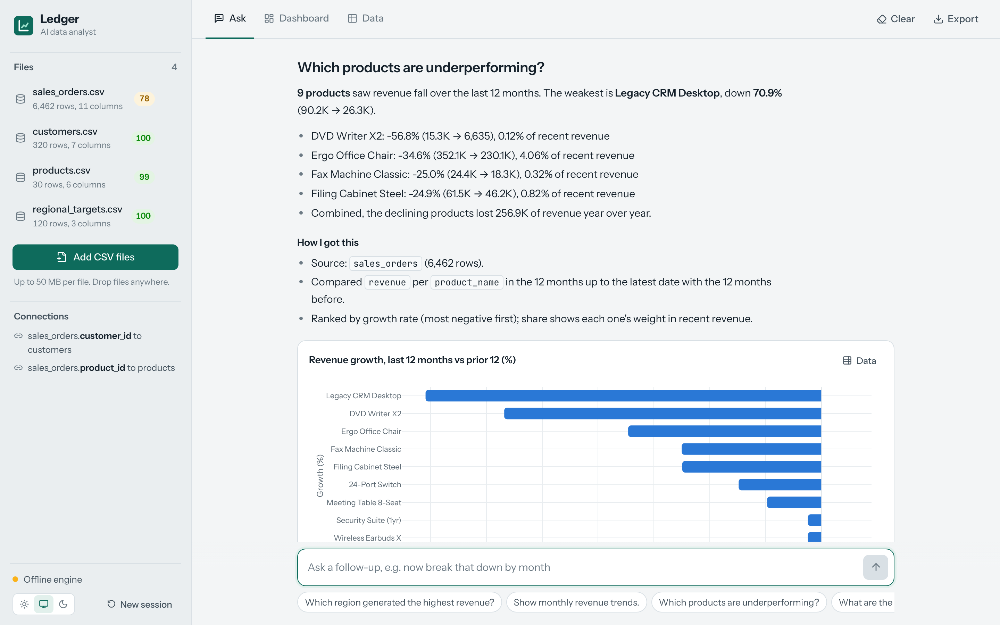 |
| **Top customers (multi-file join) + generated SQL**<br>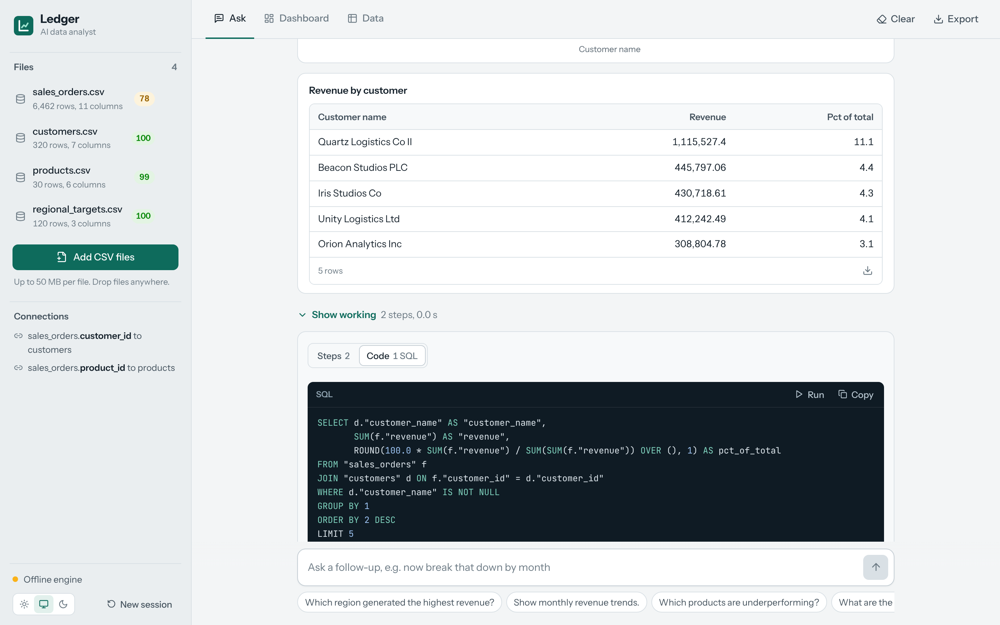 | **Anomalies, each with a reason**<br>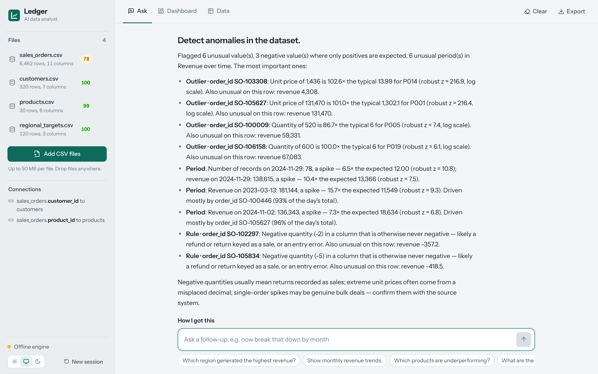 |
| **Forecast with intervals and backtest**<br>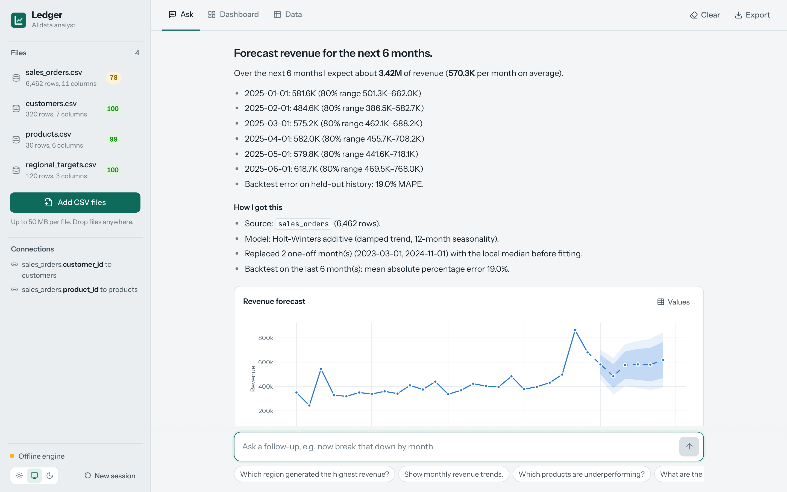 | **Actual vs target across files**<br>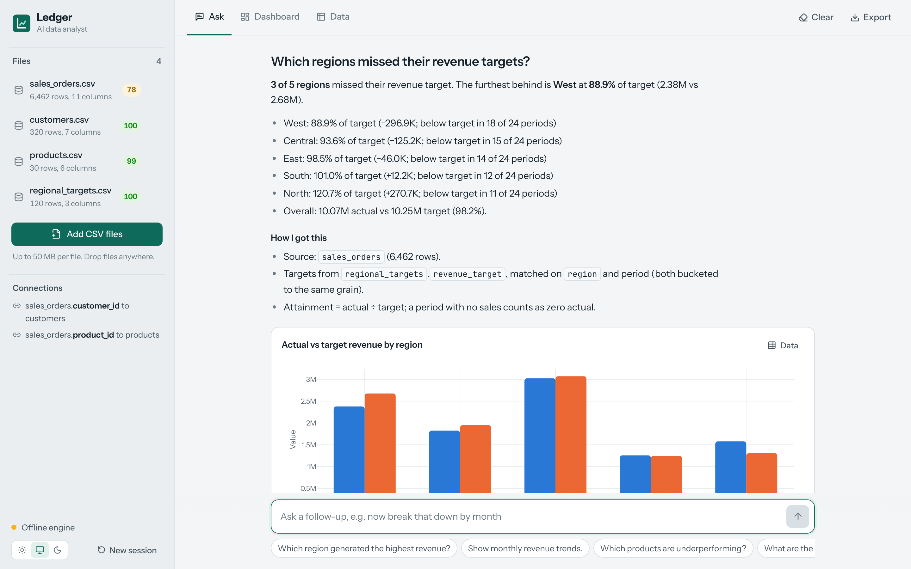 |
| **Auto-generated dashboard**<br>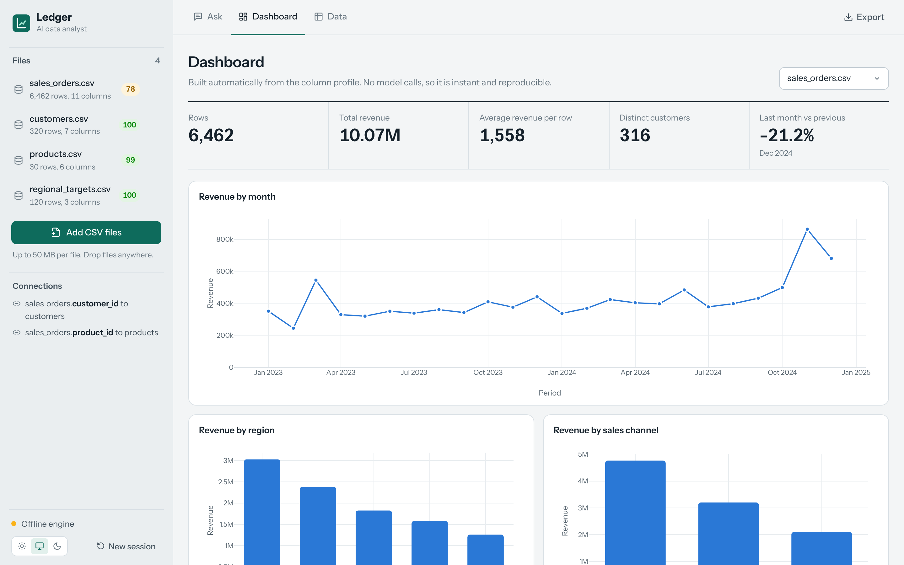 | **Data quality and profile**<br>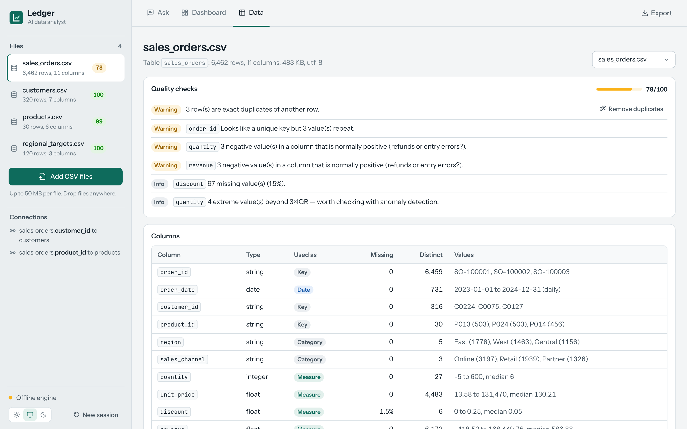 |

---

Shortcuts: `make install`, `make test`, `make lint`, `make evals`, `make docker`, `make demo`. Licensed under MIT.
