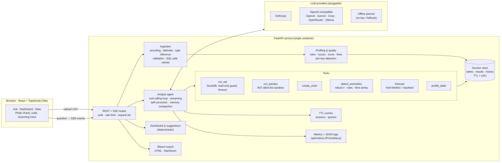

# Architecture and design notes

## Request lifecycle

1. **Session.** The UI creates a session (`POST /api/sessions`). A session owns an in-memory DuckDB connection, the loaded tables and their profiles, detected relationships, stored tool results (`r1`, `r2`, …) and the conversation history.
2. **Upload.** Each file goes through `data/ingestion.py`:
   - decode (BOM → UTF-8 → charset detection → Latin-1);
   - sniff the delimiter, parse everything as text, and drop blank rows and unnamed empty columns;
   - skip ragged rows and report them;
   - sanitise headers into unique snake_case identifiers;
   - infer types: numbers (including `$1,234`, `(12)`, `15%`), dates (ISO, then mixed formats), booleans. Codes with leading zeros stay as text.

   Every change becomes an `IngestNote` shown in the UI.
3. **Profile.** `data/profiling.py` assigns each column a semantic role (`time`, `measure`, `dimension`, `identifier`, `flag`, `text`), computes stats and top values, runs the quality checks and scores the table. `data/relationships.py` finds join keys by name and value overlap and labels their cardinality.
4. **Question.** `POST /chat` streams Server-Sent Events. `AnalystAgent.run()`:
   - builds the system prompt from the profiles (`agent/prompts.py`) and the history from memory (`agent/memory.py`);
   - loops: stream an LLM response → execute tool calls in a worker thread → append the results → repeat, up to `AGENT_MAX_STEPS`;
   - on the last round, offers no tools and instructs the model to answer;
   - emits `final` with the answer, artifacts, steps, code, usage and timing, records the turn and caches it.
5. **Render.** The UI renders tokens as they arrive. Charts, tables, anomaly lists, forecasts and quality cards render as artifacts. **Show working** lists every step with its purpose, input, code and preview.

## Provider abstraction

`agent/llm/base.py` defines neutral `Message`, `ToolCall`, `ToolSpec` and `LLMEvent` types, and a `stream()` protocol.

| Adapter | Covers | Notes |
|---|---|---|
| `AnthropicProvider` | Claude models | Native tool use, streamed text, `cache_control` on the system prompt and tool block. Parallel tool results are grouped into one user turn. |
| `OpenAICompatibleProvider` | OpenAI, Gemini, Groq, OpenRouter, Ollama | Accumulates streamed tool-call argument fragments by index. Tolerates malformed JSON arguments, which go back to the model as a tool error. |
| `OfflineProvider` | No key / fallback | Deterministic intent planner that emits the same tool calls and writes answers from the results. |

Contract tests run both real SDKs against wire-format streams, so a change in the SDKs or adapters is caught without network access.

## Tools

| Tool | Purpose | Output to the model | Output to the UI |
|---|---|---|---|
| `run_sql` | DuckDB SELECT | columns, ≤40 rows, `result_id` | step preview, optional table |
| `run_pandas` | sandboxed pandas | same as SQL, or a scalar | step preview, optional table |
| `create_chart` | chart from a `result_id` or SQL | chart id + notes | Plotly figure |
| `detect_anomalies` | outliers, rules, time series | top flags with reasons | anomaly list + chart |
| `forecast` | Holt-Winters | forecast table + backtest | forecast chart + table |
| `profile_table` | quality report | full profile | quality card |

Results returned to the model are compact (rows as arrays, rounded floats, truncated). Full results stay on the server and are referenced by id. This keeps the context small and stops the model from re-typing data into a chart.

## Anomaly detection

1. **Robust outliers.** Modified z-score `0.6745 (x − median) / MAD`, threshold 3.5. Right-skewed positive measures are scored on a log scale. Price-like columns are scored within product or category groups, so a £390 mouse is caught even though £390 is normal for a monitor.
2. **Rules.** Negative values in columns named like quantities, prices or amounts that are otherwise never negative.
3. **Time series.** The primary measure (and record count) per day or week, compared against a centred rolling median. Spikes and drops are scored with the same robust z and attributed to the record that contributed most.

Each anomaly carries `value`, `expected`, `score`, `severity`, the record context and a sentence explaining it.

## Forecasting

Additive Holt-Winters with a damped trend when there are two full seasons, otherwise damped Holt. Parameters are fitted by grid search on one-step-ahead error. One-off outlier periods are replaced by a local median before fitting. Intervals widen with the horizon. The backtest holds out the last *k* periods and reports MAPE.

## Memory

- The last `AGENT_HISTORY_TURNS` turns are replayed verbatim (tool calls plus truncated tool results). The model can say "as above" and reuse a previous query.
- Older turns become `question → answer (+ SQL used)`.
- The total is bounded at ~90k characters, and the oldest turns are dropped first.

## Caching

- **Answer cache.** Key: session data fingerprint + provider/model + normalised question + recent history. A hit replays steps, artifacts and the answer instantly. Fallback answers are not cached.
- **Query cache.** Key: data fingerprint + SQL. Cleared when a quality fix changes a table.
- **Prompt caching** (Anthropic): the static tool block and the system prompt are marked `ephemeral`.

## Observability

- Every request gets an `x-request-id`. Logs carry the request and session IDs (`LOG_FORMAT=json` in production).
- `metrics` records counters and latency summaries: HTTP, LLM calls (ok/error), LLM latency, tokens in/out, tool calls (ok/error) and latency, SQL queries (ok/error/timeout), cache hits and misses, uploads, rate-limit rejections.
- `GET /api/metrics` returns JSON, and `?format=prometheus` returns Prometheus text.
- Each answer shows provider, model, steps, time and tokens in the UI.

## Error handling

- Domain errors subclass `AppError` with a stable `code`, an HTTP status and a user-facing message. All API errors share one JSON shape.
- Tool errors are never fatal. They return to the model as `is_error` tool results so it can recover.
- LLM failures: before any tool ran → offline fallback (configurable); mid-analysis → return what was computed with an explanation.
- Unhandled exceptions are logged with a traceback and answered with a generic 500. Internals are never leaked.
